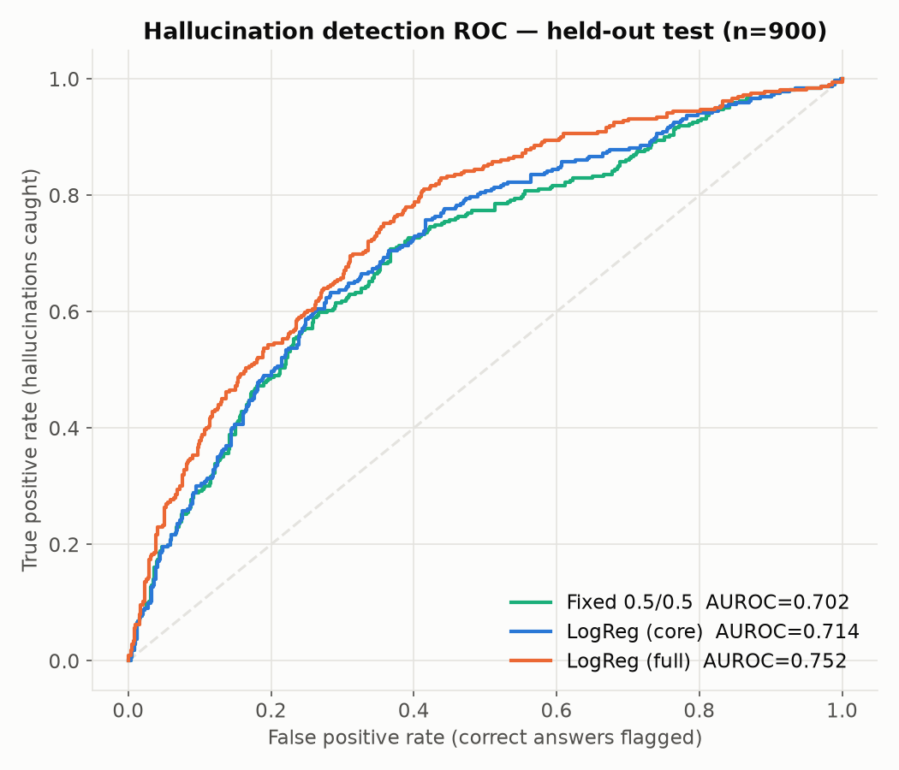
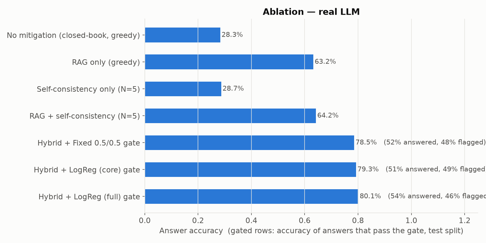

# 🛡️ HalluciGuard — LLM Hallucination Mitigation Pipeline


-6f42c1)


> **Mini Project** — 2nd Semester, MIT-ADT University
> **Paper:** *"Demystifying Machine Imagination: A Comprehensive Review of Hallucination Control in Large Language Models"*
> **Author:** Kashyap Barad et al.
> **Project page:** [kashyap1757.github.io/Hallucination-Mitigation](https://kashyap1757.github.io/Hallucination-Mitigation/)

---

## 📌 Overview

HalluciGuard is a **4-stage hybrid pipeline** that detects and mitigates hallucinations in Large Language Model answers. It combines the techniques surveyed in the accompanying IEEE conference paper — retrieval grounding, self-consistency sampling, uncertainty estimation and NLI verification — into a single gate that marks each answer as **VERIFIED** or **FLAGGED**.

```
Query ─► [1. RAG Retrieval] ─► [2. Multi-Sample LLM] ─► [3. Uncertainty + NLI] ─► [4. Gate] ─► ✅ VERIFIED / ⚠️ FLAGGED
```

## 🏗️ Architecture

| Stage | Paper Section | Technique | **Real-LLM evaluation** (`run_benchmark_eval.py`) | Prototype (`pipeline.py`, API, dashboard) |
|---|---|---|---|---|
| **1** | §II-A | Retrieval-Augmented Generation | `all-MiniLM-L6-v2` + FAISS over 2928 passages | TF-IDF cosine retrieval |
| **2** | §II-C, §II-F | Self-Consistency Sampling | **Llama-3.2-1B-Instruct**, N = 5 samples, largest semantic cluster | `SimulatedLLM`, N = 5 + majority vote |
| **3a** | §II-G | Uncertainty Estimation | Semantic entropy (bidirectional NLI clustering) + token log-prob | Shannon entropy over strings |
| **3b** | §II-F | Post-hoc Verification | `cross-encoder/nli-deberta-v3-base` | Lexical-overlap NLI |
| **4** | §II-F, Table I | Hallucination Gate | **Logistic-regression H-score** (5 features) | Logistic-regression H-score (core, 2 features) |

**Hallucination score — logistic regression** (learned from 2100 labelled real-LLM answers)

```
H = σ(β₀ + β·x) = P(hallucination)
core:  H = σ(−1.385 + 2.073·U + 0.871·(1−E))                                    flag if H ≥ 0.521
full:  H = σ(−2.074 + 1.373·U + 0.481·(1−E) + 0.469·C + 1.152·(−ℓ) + 2.008·(1−R))   flag if H ≥ 0.470
```
U = semantic entropy of the samples · E / C = DeBERTa entailment / contradiction · ℓ = LLM mean token log-prob · R = retrieval similarity.
This replaces the earlier hand-weighted `H = 0.5·U + 0.5·(1−E)` (still available as `compute_hallucination_score_fixed`).

> **Note:** the main evaluation (`run_benchmark_eval.py`) uses a **real LLM** (Llama-3.2-1B-Instruct, local GPU) that never sees the reference answers. The older prototype scripts, API and dashboard still use `SimulatedLLM` for fast, reproducible demos.

## 📊 Results

### Real-LLM evaluation — 3000 questions, 4 benchmarks (latest)

Llama-3.2-1B-Instruct · RAG over 2928 passages · N = 5 samples · H-score fitted on 2100, tested on 900 held-out questions.

| Configuration | Accuracy |
|---|:---:|
| No mitigation (closed-book) | 28.3% |
| RAG only | 63.2% |
| RAG + self-consistency | 64.2% |
| **+ logistic H-score gate** (answers passed) | **80.1%** (46% flagged) |

| Hallucination detection (test, n = 900) | AUROC | Precision | Recall | F1 |
|---|:---:|:---:|:---:|:---:|
| Fixed 0.5/0.5 formula | 0.702 | 51.2% | 68.9% | 58.7% |
| Logistic — core (same 2 features) | 0.714 | 51.7% | 70.2% | 59.6% |
| **Logistic — full (5 features)** | **0.752** | **54.2%** | **70.2%** | **61.2%** |

AUROC gain of the full logistic model over the fixed formula: **+0.050 (95% bootstrap CI +0.028 to +0.072)**. Correctness judge agreement with a manual audit: 91.7%.

<p align="center">
  
  
</p>

Full write-up: [`docs/REAL_LLM_AND_LOGISTIC_HSCORE.md`](docs/REAL_LLM_AND_LOGISTIC_HSCORE.md) · Raw metrics: [`results/real_llm/`](results/real_llm/)

### Earlier evaluations (SimulatedLLM)

> These runs pre-date the real LLM and the TruthfulQA answer-parsing fix; kept for reference.


#### Production evaluation — full TruthfulQA (817 questions)

| Metric | Value |
|---|---|
| Answer accuracy | **90.45%** (739 / 817) |
| Hallucination detection recall | **75.64%** (caught 59 of 78 wrong answers) |
| Detection precision | 22.61% |
| Detection F1 | 34.81% |
| Gate flag rate | 31.95% |
| Mean uncertainty / NLI grounding / H-score | 0.466 / 0.659 / 0.403 |
| Runtime (CPU) | 371 s |

#### Ablation study (first 200 questions)

| Configuration | Accuracy | Recall | Flag rate |
|---|:---:|:---:|:---:|
| No mitigation (raw LLM) | 83.0% | — | 0% |
| RAG only (TF-IDF) | 91.5% | — | 0% |
| RAG only (FAISS + Sentence-Transformers) | 91.5% | — | 0% |
| Self-consistency only (N = 5) | 91.5% | — | 0% |
| Hybrid (TF-IDF + lexical overlap) | 98.5% | 66.7% | 13.5% |
| **Hybrid (FAISS + DeBERTa NLI)** | **98.5%** | **100%** | 25.5% |

**Key findings**
- Retrieval grounding gives the largest single jump in accuracy (83% → 91.5%).
- Only the hybrid configurations can *detect* hallucinations; the full production stack caught every wrong answer in the ablation subset.
- High recall comes at the cost of precision — many correct answers are flagged conservatively. Tuning τ trades one for the other.

<p align="center">
  
  
</p>

Full write-up: [`docs/PRODUCTION_MIGRATION_AND_RESULTS.md`](docs/PRODUCTION_MIGRATION_AND_RESULTS.md) · Raw metrics: [`results/production/`](results/production/)

## 📁 Repository Structure

```
Hallucination-Mitigation/
├── src/                          # Source code
│   ├── run_benchmark_eval.py     # ★ Real-LLM evaluation on 3000 samples + logistic H-score
│   ├── benchmarks.py             # Builds the 3000-sample multi-benchmark set
│   ├── real_llm.py               # Local HF LLM backend (Llama-3.2-1B-Instruct by default)
│   ├── hscore.py                 # Fixed vs. logistic-regression hallucination score
│   ├── env_compat.py             # Works around a mismatched torchvision install
│   ├── pipeline.py               # Core 4-stage pipeline (prototype, synthetic + TruthfulQA)
│   ├── run_real_dataset.py       # Runs the prototype pipeline on the TruthfulQA CSV
│   ├── run_production_test.py    # Production evaluation (FAISS + DeBERTa NLI)
│   ├── evaluate.py               # Metrics report + static charts
│   ├── dashboard.py              # Interactive Streamlit dashboard
│   └── api.py                    # FastAPI REST service
├── scripts/
│   ├── inspect_dataset.py        # Quick look at the dataset CSVs
│   ├── show_results.py           # Print a summary of TruthfulQA results
│   └── final_checks.py           # Bootstrap CIs + manual judge audit for the real-LLM run
├── tests/
│   └── test_api.py               # Smoke tests against a running API
├── data/                         # TruthfulQA CSVs + benchmark_3000.jsonl (4 benchmarks)
├── results/
│   ├── results.json              # Latest per-question output (read by dashboard / API / evaluate)
│   ├── results_truthfulqa.json   # Prototype run on TruthfulQA
│   ├── production/               # Production run: full results + metrics summary
│   └── real_llm/                 # Real-LLM run: generations, metrics, fitted H-score models
├── figures/
│   ├── real_llm/                 # Charts from run_benchmark_eval.py
│   ├── production/               # Charts from run_production_test.py
│   ├── truthfulqa/               # Charts from run_real_dataset.py
│   └── evaluation/               # Charts from evaluate.py
├── docs/
│   ├── SYSTEM_DOCUMENTATION.md   # Full system documentation
│   ├── PRODUCTION_MIGRATION_AND_RESULTS.md
│   ├── hallucination_doc.md      # Original design notes
│   └── reports/                  # IEEE paper, project overview, results & seminar reports (.docx)
├── index.html                    # GitHub Pages landing page
├── requirements.txt
└── README.md
```

## 🚀 Quick Start

```bash
# 1. Clone
git clone https://github.com/kashyap1757/Hallucination-Mitigation.git
cd Hallucination-Mitigation

# 2. (Optional) create a virtual environment
python -m venv venv
venv\Scripts\activate          # Windows
# source venv/bin/activate     # macOS / Linux

# 3. Install dependencies
pip install -r requirements.txt
```

All commands below are run from the repository root.

### Run the pipeline

```bash
python src/pipeline.py                                   # synthetic demo dataset
python src/pipeline.py --query "Who was the first president?"
python src/pipeline.py --ablation                        # ablation study
python src/pipeline.py --rate 0.40 --samples 7 --threshold 0.55
```

### Real-LLM evaluation (3000 samples)

```bash
python src/benchmarks.py                                 # build data/benchmark_3000.jsonl
python src/run_benchmark_eval.py                         # ~75 min on an 8 GB GPU (cached afterwards)
python src/run_benchmark_eval.py --limit 200             # quick check
python src/run_benchmark_eval.py --llm Qwen/Qwen2.5-1.5B-Instruct   # another model
python scripts/final_checks.py                           # bootstrap CIs + judge audit
```

> Requires a CUDA GPU for reasonable speed; the first run downloads the LLM (Llama 3.2 is gated — accept its licence on Hugging Face and `huggingface-cli login`).

### Evaluate on TruthfulQA (SimulatedLLM)

```bash
python src/run_real_dataset.py --limit 100               # prototype pipeline
python src/run_production_test.py --ablation             # production models, all 817 Qs
python src/run_production_test.py --limit 50             # quick check
python src/evaluate.py                                   # metrics + charts from results/results.json
```

> The first production run downloads `all-MiniLM-L6-v2` and `nli-deberta-v3-base` from Hugging Face.

### Interactive dashboard

```bash
streamlit run src/dashboard.py
```

### REST API

```bash
uvicorn api:app --app-dir src --reload --port 8000
# Swagger UI: http://localhost:8000/docs

python tests/test_api.py      # in another terminal, with the API running
```

| Method | Endpoint | Description |
|---|---|---|
| `GET` | `/health` | Service status |
| `POST` | `/check` | Run the pipeline on one question |
| `POST` | `/check/batch` | Run the pipeline on several questions |
| `GET` | `/results`, `/results/{index}` | Stored per-question results |
| `GET` | `/metrics` | Aggregate evaluation metrics |
| `GET` | `/ablation` | Run an ablation study |
| `GET` | `/dataset/info`, `/dataset/categories`, `/dataset/questions` | Dataset exploration |

## 📄 Documentation & Reports

- [System documentation](docs/SYSTEM_DOCUMENTATION.md)
- [Real LLM, 3000 samples & logistic H-score](docs/REAL_LLM_AND_LOGISTIC_HSCORE.md)
- [Production migration & results](docs/PRODUCTION_MIGRATION_AND_RESULTS.md)
- [IEEE conference paper](docs/reports/IEEE_Final_Conference_Paper_Updated.docx)
- [Project overview](docs/reports/Project_Overview.docx) · [Results & evaluation](docs/reports/Results_and_Evaluation.docx) · [Technical seminar report](docs/reports/Technical%20Seminar%20Report%20Format.docx)

## 📚 References

- Lin et al. (2022) — *TruthfulQA: Measuring How Models Mimic Human Falsehoods*
- Lewis et al. (2020) — *Retrieval-Augmented Generation for Knowledge-Intensive NLP Tasks*
- Wang et al. (2023) — *Self-Consistency Improves Chain of Thought Reasoning in Language Models*
- He et al. (2021) — *DeBERTa: Decoding-enhanced BERT with Disentangled Attention*
- Li et al. (2023) — *HaluEval: A Large-Scale Hallucination Evaluation Benchmark*
- Welbl et al. (2017) — *Crowdsourcing Multiple Choice Science Questions* (SciQ)
- Rajpurkar et al. (2016) — *SQuAD: 100,000+ Questions for Machine Comprehension of Text*
- Kuhn et al. (2023) — *Semantic Uncertainty: Linguistic Invariances for Uncertainty Estimation in NLG*

---

**MIT-ADT University** · 2nd Semester Mini Project · [Kashyap Barad](https://github.com/kashyap1757)
